# Issue #51: tidier River of Time on narrow screens

The v2 page nav now lists only the *other* pages, since the current page is already the hero title. At 1180px and below it collapses into a burger menu next to the home mark. This applies to River, Concert Hall and Lexicon. On the River page, the find-a-composer field shrinks to a magnifier button between 641px and 1499px wide. It expands when you click it, press `/`, or type in it. Below 1180px the subtitle is hidden so the title no longer runs into the nav or the search field. Before this change, the nav links were hidden entirely at 640px and below. Now they stay reachable through the burger.

## River of Time, 899×952 (the width in the issue)

| **Before (main)** | **After (this PR)** |
|---|---|
| 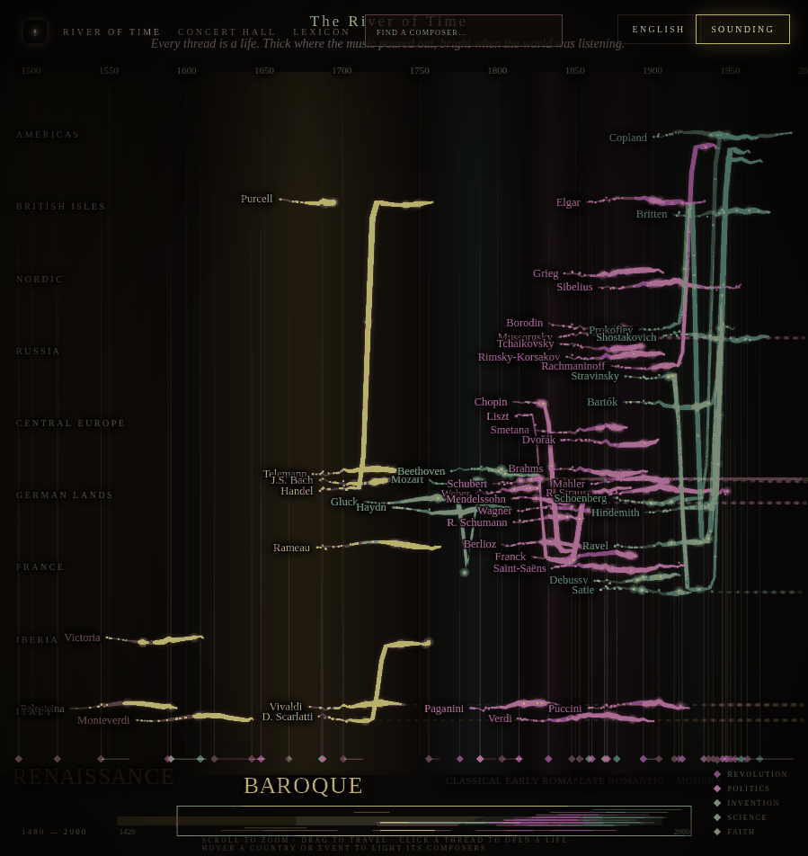 |  |

The title, subtitle, nav and search no longer overlap. The nav is now a burger menu and search is a magnifier button.

## River of Time, 899×952, menu open

| **Before (main)** | **After (this PR)** |
|---|---|
|  | 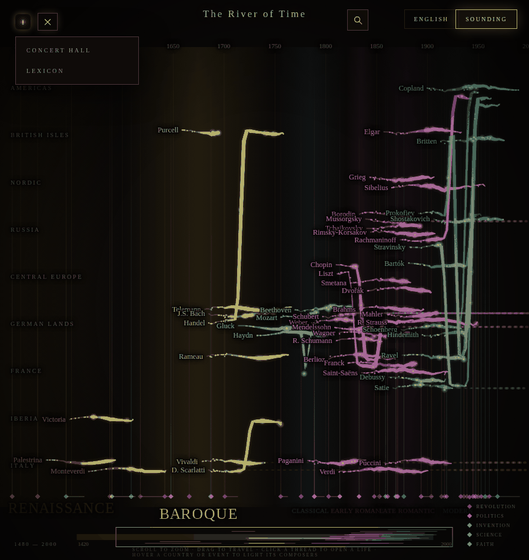 |

The burger opens a dropdown with Concert Hall and Lexicon. River of Time is not listed because it is the current page.

## River of Time, 1024×768

| **Before (main)** | **After (this PR)** |
|---|---|
| 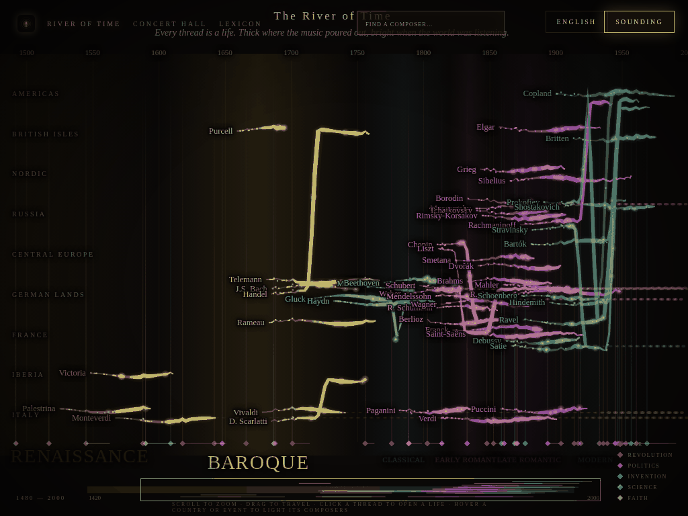 | 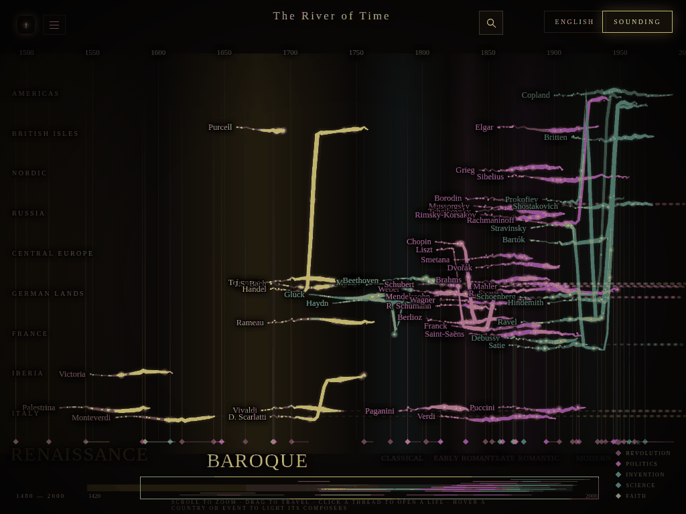 |

Same fix at a small-laptop width.

## River of Time, 1440×900

| **Before (main)** | **After (this PR)** |
|---|---|
| 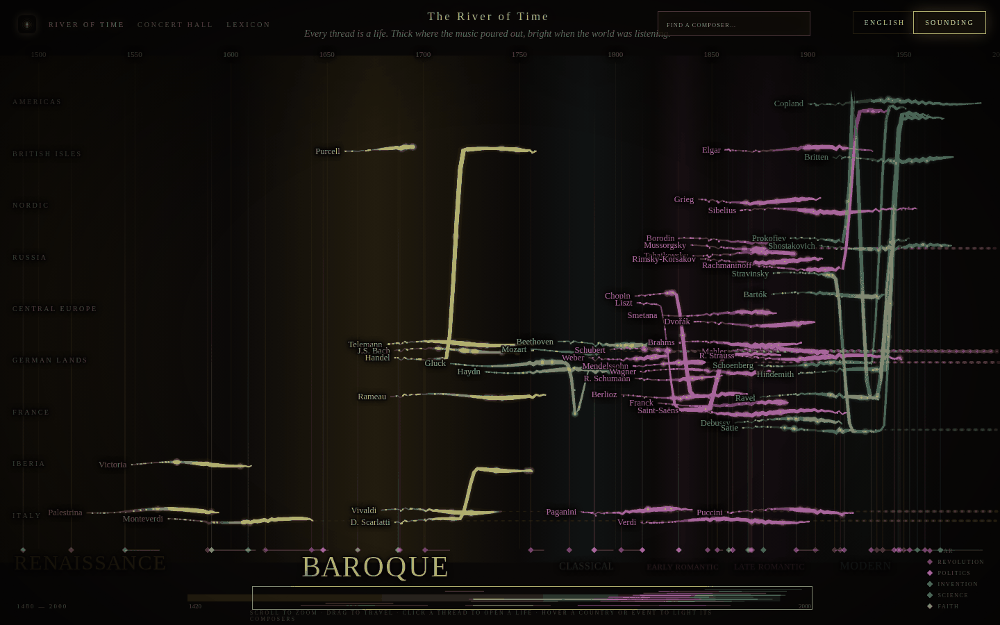 | 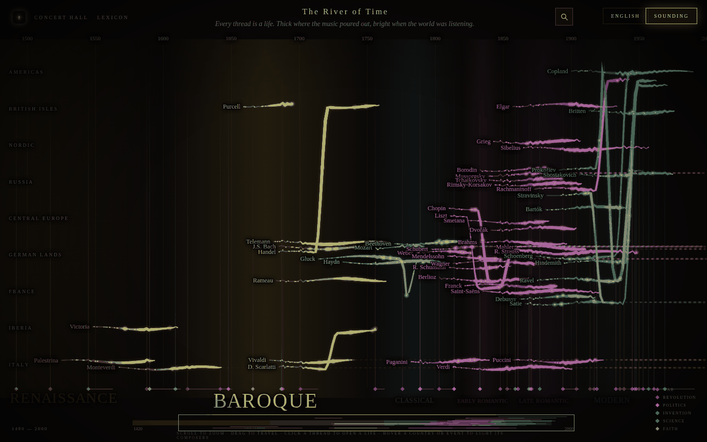 |

The inline nav no longer lists River of Time. Search is a magnifier button, so the subtitle no longer runs under the search field.

## River of Time, 844×390 (landscape phone), menu open

| **Before (main)** | **After (this PR)** |
|---|---|
| 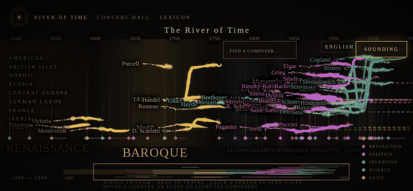 | 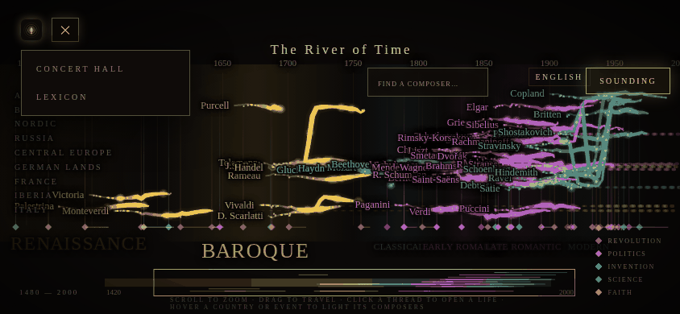 |

The four inline nav items are replaced by the burger menu.

## Lexicon, 899×952, menu open

| **Before (main)** | **After (this PR)** |
|---|---|
| 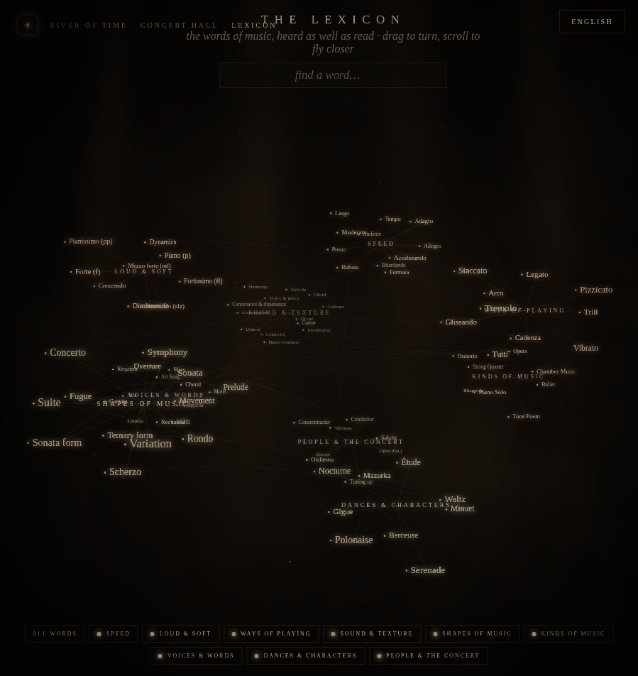 | 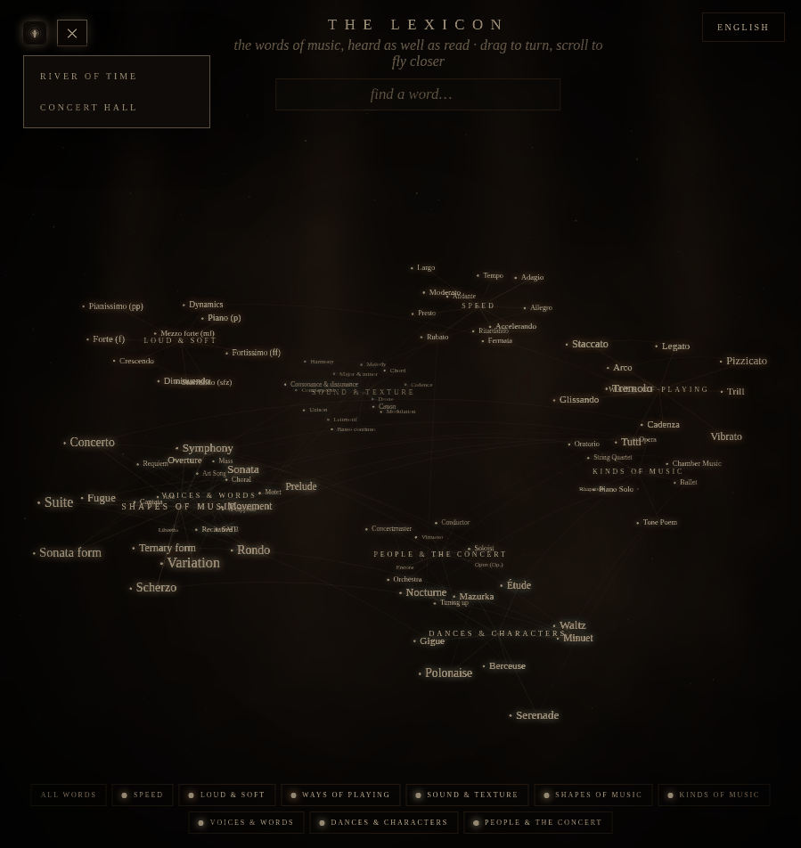 |

The "Lexicon" nav link used to collide with "The Lexicon" title. It is now dropped, and the other pages sit behind the burger.

## Concert Hall, 1440×900

| **Before (main)** | **After (this PR)** |
|---|---|
| 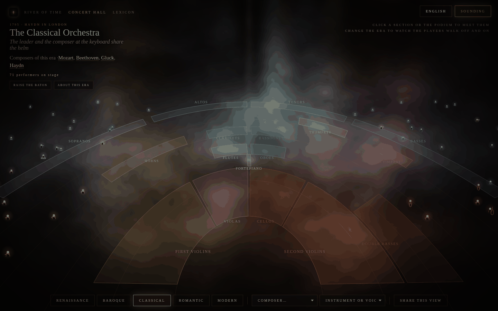 | 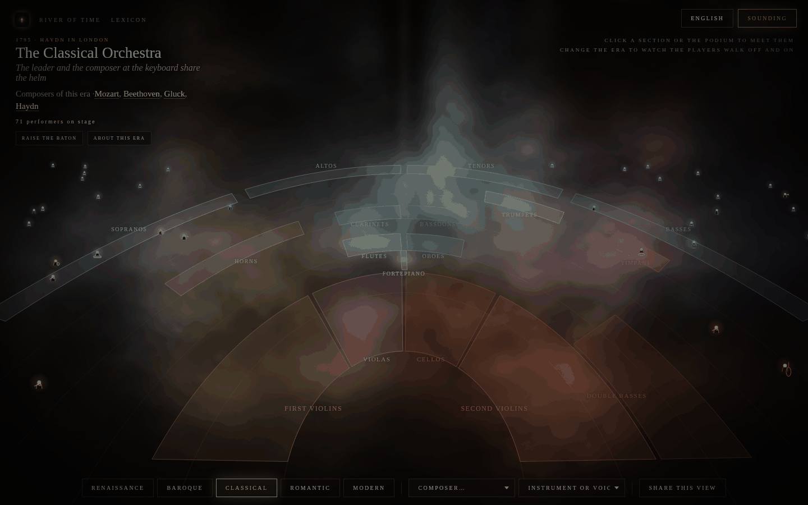 |

On wide screens the nav stays inline and only drops the current page.

## How to verify

- `/v2/river.html` at about 900px wide: no overlap at the top. Clicking the burger opens Concert Hall and Lexicon. Esc, clicking outside, or tabbing away closes it.
- `/v2/river.html` at 1024 or 1440px wide: click the magnifier or press `/`. The field expands and searching for "Bach" works.
- `/v2/river.html?lang=fr-FR` (also `af-ZA`, `es-ES`, `pl-PL`): the burger has a translated "Menu" label, and the nav links are translated by their `href`.
- `/v2/terms.html` and `/v2/hall.html`: the nav lists only the other two pages.
