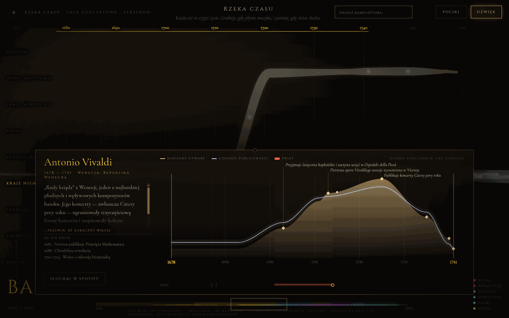
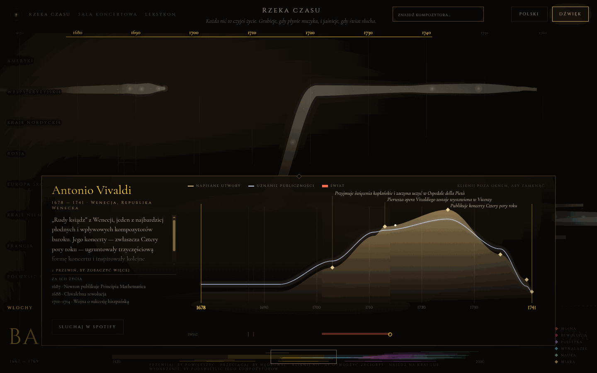

# PR #50 review fixes

## Review fixes

| Before (commit `6c387d4`) | After (this PR) |
|---|---|
|  |  |

With the Polish UI, Vivaldi’s model home moves from German lands to Italy; Chopin remains in Central Europe.

River now preserves each composer’s English nationality key for region mapping while keeping the localized nationality for display. A valid `?lang=` selection is saved for subsequent pages. Silence stops scheduled voices in Hall, River and Home without suspending the audio context; Hall also cancels its pending sync and visual motif timers.

### No visual change

- **Locale persistence:** Start with `i18nextLng` set to `en-GB`, open `index.html?lang=pl-PL`, choose “Enter in silence”, then follow the Hall link. The destination has no language query and should still have `<html lang="pl-PL">`.
- **Silence:** In Hall, unlock audio, click “Raise the baton”, then click “Silence” within 0.5 seconds. Active audio sources should reach zero within 300 ms and remain at zero for five seconds. River and Home use the same source-stopping behavior when silenced.

### Verification

`node public/v2/tools/check-i18n.mjs`, `check-river-nationality.mjs` and `check-hall.mjs`, plus `npm run i18n:strict` and `npm run test:run`, all pass. Raw logs are kept locally in `test-artifacts/` (gitignored), not committed.
