# Requiem of Everything — the rebuild (v2)

> "I would like to rebuild, and I stress rebuild, the Requiem of Everything into a hauntingly beautiful site that draws in newcomers and avid fans of classical music into a joyous interactive experience."

This report compares the **old site** (the React app on `main`) with the **new site** built in one Devin session: <https://app.devin.ai/sessions/3b05c5bc8d3f4f8384ab4a1c4492e415>. The new site lives in [`public/v2/`](../../public/v2/), so once it's merged it is served at `/requiem-of-everything/v2/` alongside the current site.

Every screenshot is 1440×900, taken in headless Chrome. The old site was built from `main`; the new site comes from this branch.

## At a glance

| | Old site (`main`) | New site (v2) |
|---|---|---|
| Arrival | A dense timeline of bars, straight away | An eye-level walk through infinite darkness: light columns, incense, a floor you drift across, and votive voices that follow your clicks |
| Navigation | Header tabs: Timeline · Terms · Orchestra · Credits | Three glowing halos: River of Time · Concert Hall · Lexicon. The Votive icon takes you home |
| Composers | 51 bars on a timeline | 51 living threads whose thickness and brightness show how much they wrote and how much they were heard. Each has a fact-checked life arc with world events and contemporaries |
| Orchestra | A 2D seating map with family lists | A lit 3D stage from the conductor's podium, in 5 eras, plus a signature piece for six composers. Players walk off and on, tune, then play "Raise the baton" |
| Sound | Links out to Spotify | Recorded orchestral samples (VSCO 2 CE, Sonatina) in the Hall, plus Spotify playing inside the page for 222 verified recordings |
| Terms | 27 cards in a grid | 92 terms in one explorable 3D constellation. Most have a "Hear it" demo that plays and draws the notes |
| Sharing | No deep links | Every view is a URL: `river.html#focus=…`, `hall.html#composer=gustav-mahler&instrument=cello`, `terms.html#term=pizzicato` |
| Devices | Desktop-first | Desktop and landscape phones; portrait shows a "turn your phone" prompt |

---

## 1. Timeline → Home

**Before:** the old site opens straight into the timeline. It is useful but dense, nothing moves, and nothing invites you in.

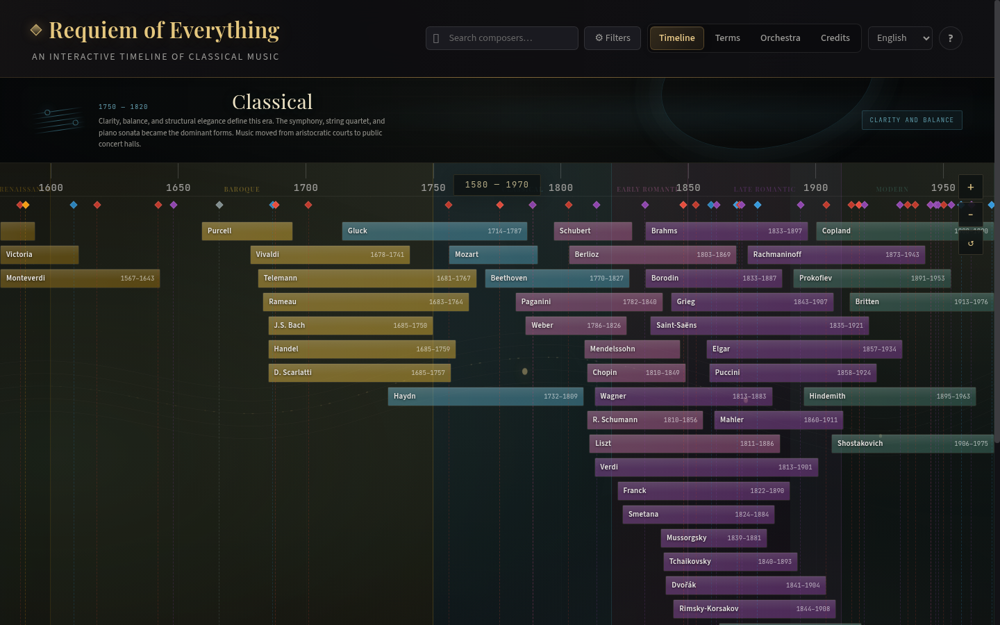

**After:** the new home page is a place rather than a page. You stand at eye level in endless dark. Shafts of light fall through incense onto the patch of floor around you. Three halos lead to the River, the Hall and the Lexicon, each with an animated emblem and its own sound.

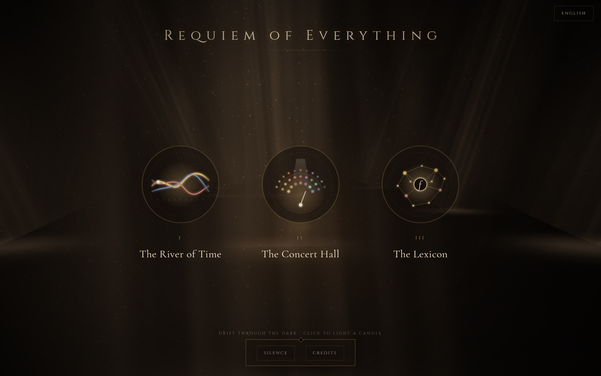

The timeline's information now lives in the **River of Time**. Each composer is a thread that swells when the music poured out and brightens when the world was listening. World events and countries light up the lives they touched. Opening a life shows its arc, its biography, the events of its lifetime and a Spotify player.

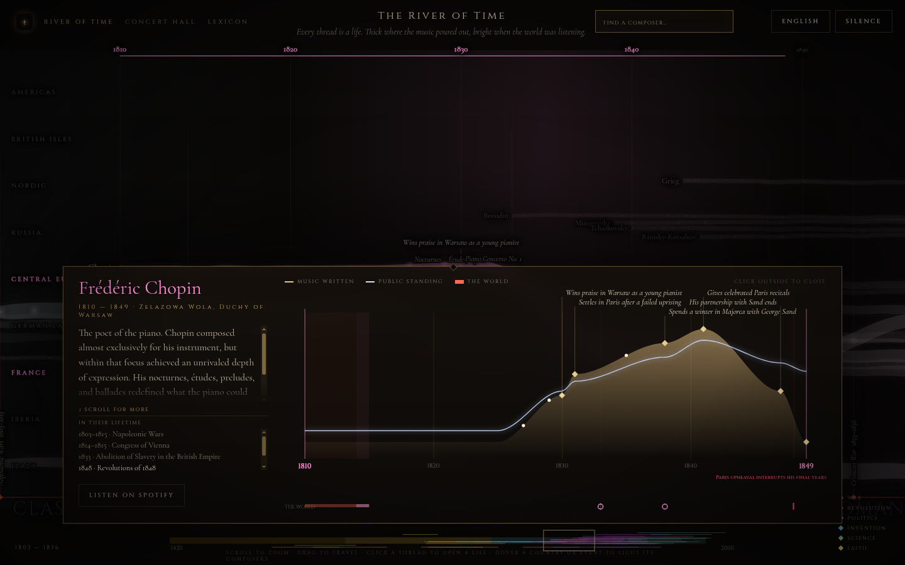

## 2. Orchestra → Concert Hall

**Before:** a flat seating diagram beside a panel of text and family lists.

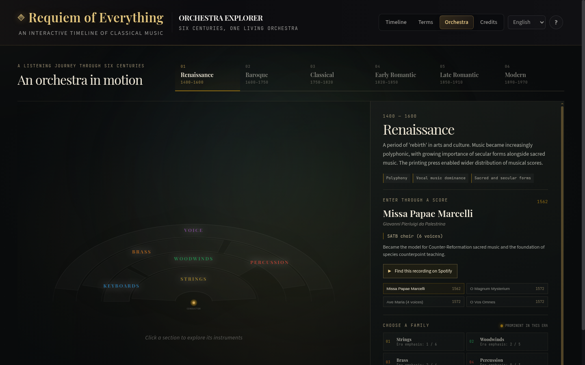

**After:** you stand on the conductor's podium. Each section sits on its own lit floor under its own lamp, with incense drifting through the light. The choir stands at the back in every era where it belongs. Changing the era or piece sends players walking off and new ones walking on. They tune and noodle, then come together on "Raise the baton". Below: Mahler's *Symphony of a Thousand*, with all 158 performers on stage.

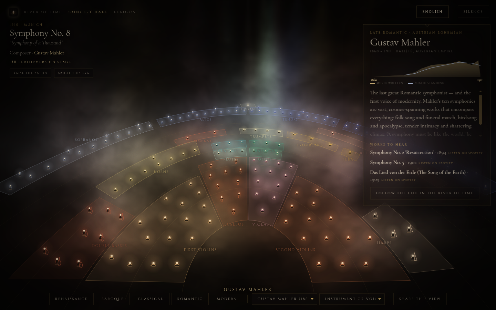

Click a section or its name to meet the instrument. Its card shows the range, its role, a showcase piece playing in the page, the player widely called the greatest, and great players.

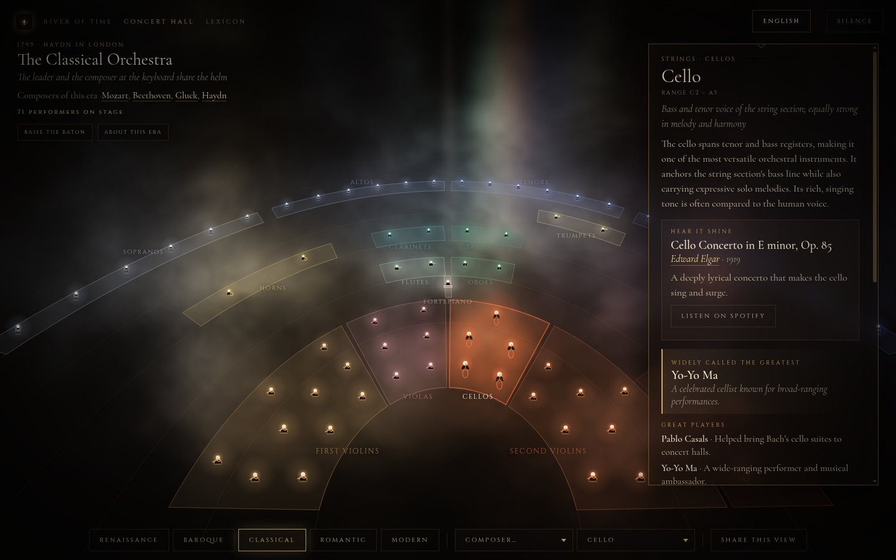

The card also shows the instrument's role in **every era**. Clicking an era moves the stage there.

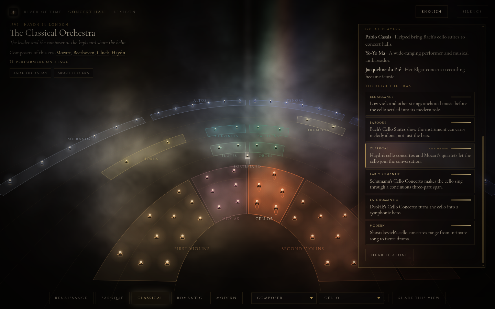

## 3. Terms → Lexicon

**Before:** a grid of 27 text cards.

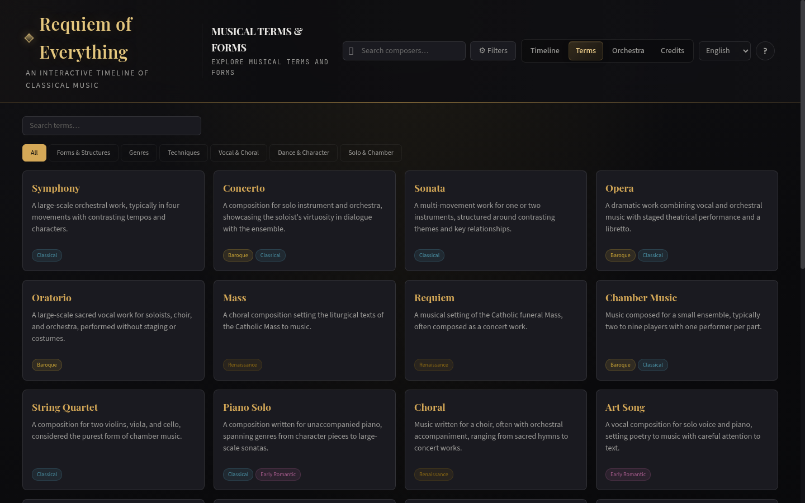

**After:** one constellation of 92 words in 9 glowing groups: Speed, Loud & soft, Ways of playing, Sound & texture, Shapes of music, Kinds of music, Voices & words, Dances & characters, and People & the concert. Drag to turn it, scroll to fly closer. Threads link related words across groups.

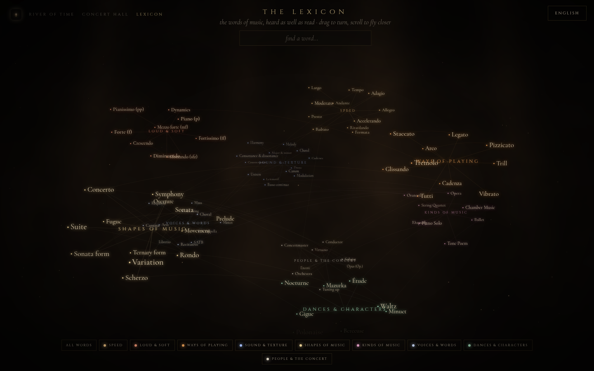

Each word gives its literal meaning and a plain definition. Most also have **Hear it**: a short example that plays while the notes draw themselves. Here a crescendo swells.

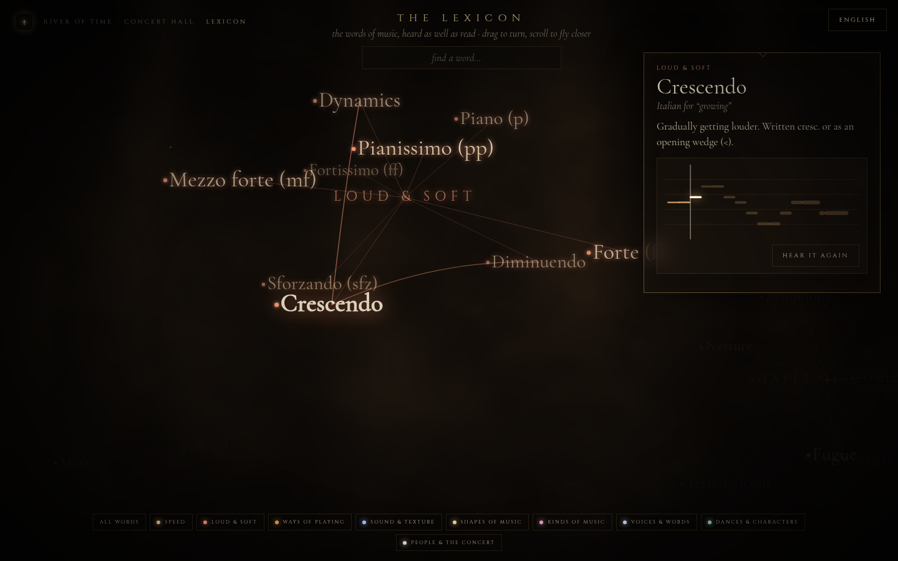

## 4. Every language, from day one

The old site already spoke English, Afrikaans, French and Spanish, and part of Polish: only 4 of its 51 composers had Polish text. The new site is fully translated into all five languages. That covers:

- the interface;
- 51 composers and 196 works;
- 47 world events;
- 51 life arcs;
- 92 Lexicon terms;
- 26 instruments, with their showcases, great players and 156 era notes.

An automated check confirms that every locale covers 100% of every namespace and that no English is left on screen. A language switcher sits on every page. It remembers your choice, which it shares with the old site's setting, and links can carry `?lang=pl-PL`.

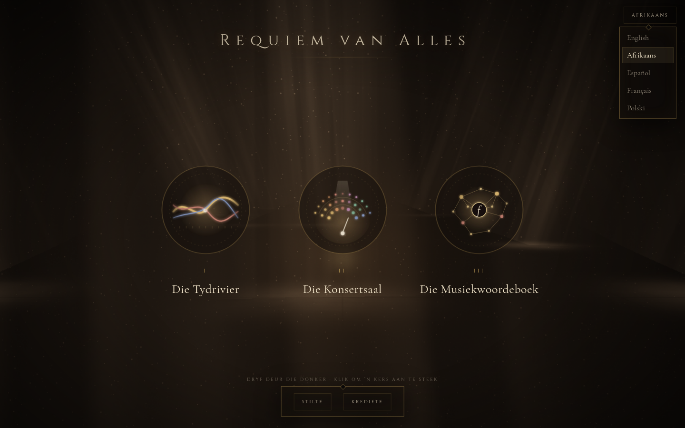

| Afrikaans: Home | Français: a life in the River |
|---|---|
| 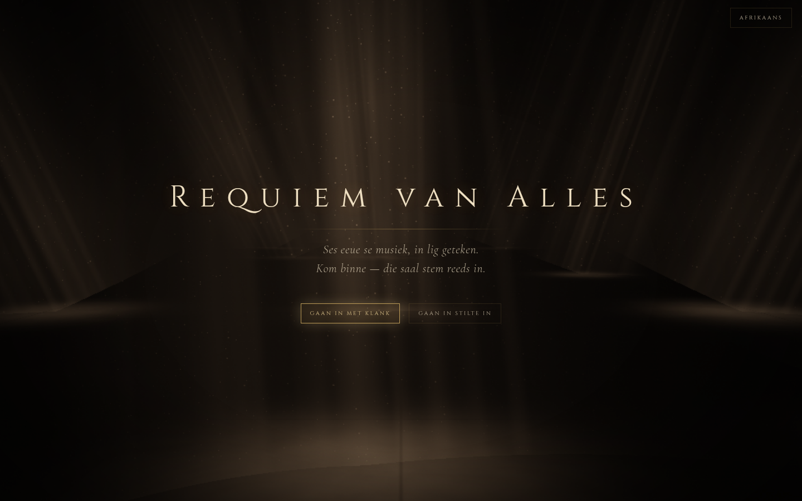 | 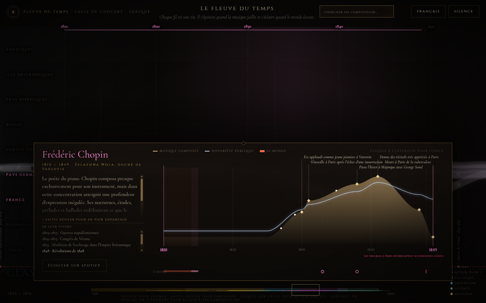 |
| **Polski: Concert Hall** | **Español: the Lexicon** |
| 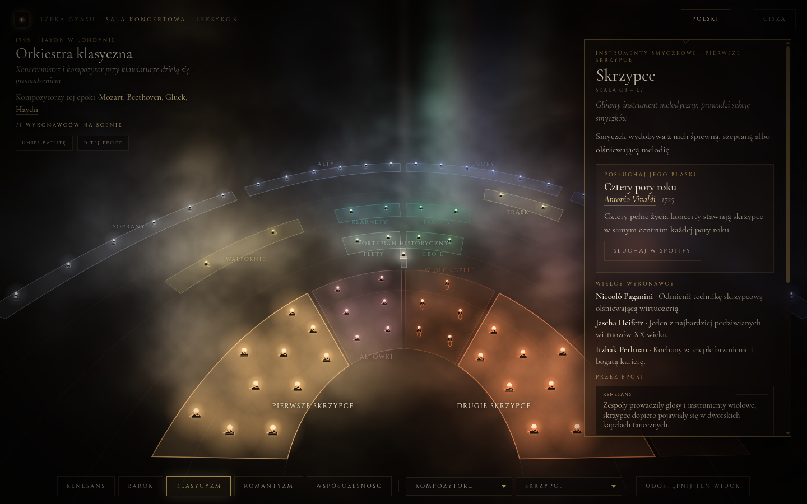 | 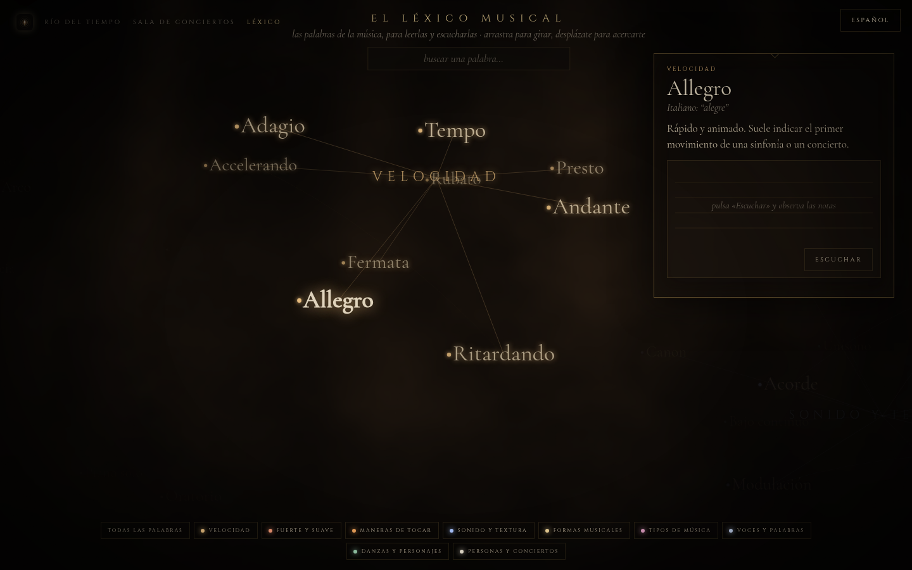 |

The translations still need a review by native speakers before launch.

---

## Under the hood

- **Research:** a life arc for each of the 51 composers, covering output and public standing over time, world events and contemporaries. Each arc was fact-checked against Wikipedia, which produced 71 corrections (log: [`public/v2/tools/factcheck-log.md`](../../public/v2/tools/factcheck-log.md)).
- **Instruments:** 26 instruments and voices, each with a showcase recording, great players and 156 era notes (one per era).
- **Listening:** 222 Spotify recordings (196 works and 26 showcases), each verified by its title through Spotify's public oEmbed endpoint and listed for review in [`spotify-review.csv`](../../public/v2/tools/spotify-review.csv). They play through Spotify's official embed, so no keys or secrets are involved.
- **Sound:** recorded orchestral samples from VSCO 2 Community Edition (CC0) and Sonatina Symphonic Orchestra (CC Sampling Plus 1.0, credited). Each instrument loads only when it is needed. Each section is layered from slightly offset voices so it sounds like a group of players.
- **Checks:** automated scripts in `public/v2/tools/` confirm that:
  - no two Hall sections or labels overlap, and every player stays in view, across 11 layouts at 3 screen sizes;
  - every Spotify ID resolves;
  - the life-arc data is complete;
  - every instrument has an era note for each of the 6 eras.
- **Static and safe:** plain HTML, Canvas and WebGL on GitHub Pages, with no build step, no backend and no secrets.

## How it was built

The rebuild was a conversation. Each round of feedback became a commit, and you can see the history in `git log -- public/v2`. Here are some of the changes it drove:

- "We're not moving through the dark" → an eye-level, infinite floor.
- "Don't like the door theme" → halos and the Votive icon.
- "Drop the seat menu, just want conductor's view" → a podium-only Hall that keeps the whole orchestra framed.
- "Sound … horrible mechanical" → recorded orchestral samples.
- "Threads too glowy" → calmer threads.
- "Card is translucent" → opaque cards over a dimmed River.
- "Voices missing" → labels that never overlap, and a choir wherever history puts one.
- "Through the eras isn't working" → interactive notes for every era.
- "River => River of Time, Hall & Voices => Concert Hall, remove the baton" → clearer names, and a stage with nothing in front of the orchestra.
- "Remove the major composers at the bottom, the feature falls flat" → the piece row is gone; choosing a composer still brings their signature piece on stage.

## Next steps

- Replace the old site at the root with v2.
- Have a native speaker review the Afrikaans, Spanish, French and Polish text.
